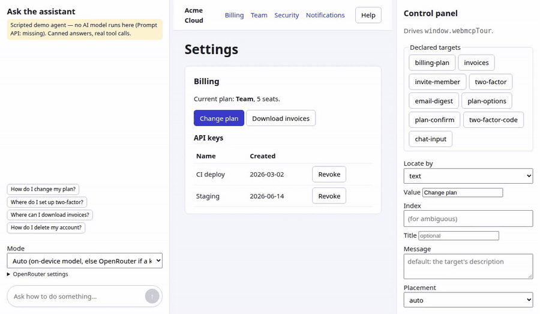

# webmcp-tour

[](https://www.npmjs.com/package/webmcp-tour)
[](https://www.npmjs.com/package/webmcp-tour)
[](https://bundlephobia.com/package/webmcp-tour)
[](https://github.com/fboldo/webmcp-tour/actions/workflows/ci.yml)
[](LICENSE)
[](package.json)

**Guided tours for AI agents, in one script tag.** Add webmcp-tour and any WebMCP agent can walk your users through your app, highlighting and explaining each step. Declare a few targets when you want to shape the tour.

> **Experimental (0.x).** The API may change between minor versions, and WebMCP itself is still experimental in browsers.



[Live demo](https://fboldo.github.io/webmcp-tour/demo/) · [Docs](https://fboldo.github.io/webmcp-tour/) · [Agent hosts](https://fboldo.github.io/webmcp-tour/agent-hosts/)

## Two ways to use it

### 1. Zero setup: one script tag

Try it (quick experiments only: always the newest version, no integrity check):

```html
<script src="https://unpkg.com/webmcp-tour"></script>
```

Production: pin the exact version and lock the file with Subresource Integrity:

```html
<script src="https://unpkg.com/webmcp-tour@0.1.0/dist/webmcp-tour.js" integrity="sha384-ZFV7oLCiB6T5KDOyhLF+G6M+t6L1P0nugi+feJ6QYJnKy8pJ1ThykxOFoV7mnn2A" crossorigin="anonymous"></script>
```

Do not use `@latest` in production: SRI is impossible and 0.x releases can break silently. The hash of a release is `curl -s https://unpkg.com/webmcp-tour@0.1.0/dist/webmcp-tour.js | openssl dgst -sha384 -binary | openssl base64 -A` (in a clone, `pnpm build && pnpm sri`). Or install from npm: `npm install webmcp-tour`.

Any WebMCP agent can now list what is on the page (`tour_list_targets` returns a visible outline of headings and controls) and point at anything by its visible text. No markup, no config.

Optional settings go in a JSON block that the script tag points to with `data-config` (JSON-safe options only: `pages`, `labels`, `pageSuggestion`, `resume`, `takeMeThere`; `navigate` is a function, so it cannot be set here). Add `data-manual` to the script tag to skip the automatic registration, or `data-no-global` to not expose `window.webmcpTour` (`{ tour, createTour, registerAsWebMcpTool }`).

```html
<script type="application/json" id="tour-config">
  { "takeMeThere": true, "labels": { "gotIt": "Entendi" } }
</script>
<script src="https://unpkg.com/webmcp-tour@0.1.0/dist/webmcp-tour.js" data-config="tour-config" integrity="sha384-ZFV7oLCiB6T5KDOyhLF+G6M+t6L1P0nugi+feJ6QYJnKy8pJ1ThykxOFoV7mnn2A" crossorigin="anonymous"></script>
```

`data-config` is the id of exactly one `<script type="application/json">` (none or several: a warning and defaults), or inline JSON when the value starts with `{`. Invalid JSON or the wrong shape also gives a warning and defaults. Config and `data-*` flags are read from `document.currentScript`, so they do not work when the file is bundled as a module. When the server renders the JSON block, escape `<` as `\u003c` (`JSON.stringify(config).replace(/</g, "\\u003c")`) so the content can never close the tag early.

### 2. Craft the experience

Install it, create a tour, register it:

```sh
npm install webmcp-tour
```

```ts
import { createTour, registerAsWebMcpTool } from "webmcp-tour";

const tour = createTour();
const { unregister } = await registerAsWebMcpTool(tour); // or pass { signal } to unregister on abort
```

There is one package entry (`webmcp-tour`) and it is side-effect free (`sideEffects: false`), so it is safe to import on the server.

**Declare a target** so the agent answers in your words, not its guess:

```html
<button data-tour-id="change-plan"
        data-tour-description="Opens the plan picker. Changes apply after you confirm.">
  Change plan
</button>
```

**Declare pages** so an agent can say "that control is on another page", offer a **Go to Security** card, and have the step resume there after the user presses Go:

```ts
const tour = createTour({
  pages: [
    { id: "billing", url: "/billing", title: "Billing" },
    { id: "security", url: "/security", title: "Security" },
  ],
  navigate: (url) => router.push(url), // default: location.assign
});
tour.defineTarget({ id: "two-factor", page: "security", label: "Set up two-factor", description: "Starts two-factor setup." });
```

**Embed it in your own tools**, so your agent's answer and the highlight arrive together:

```ts
const result = await tour.show({ target: "two-factor", message: "Press this to start." });
// { ok: true, matched } | { ok: false, error: "other_page", page, message } | { ok: true, suggested } | ...
```

Several tours on one page (say, per product area) need distinct tool names: `createTour({ toolPrefix: "billing" })` gives `billing_show_step` and friends, and `registerAsWebMcpTool([billingTour, teamTour])` registers them together.

Translations, card placement, `resume`, and the rest are in the [concepts](https://fboldo.github.io/webmcp-tour/concepts/) and [engine API](https://fboldo.github.io/webmcp-tour/engine-api/) pages.

## What agents get

Four tools, all marked `readOnlyHint`:

| Tool | What it does |
|---|---|
| `tour_list_targets` | The page outline (headings, controls with role, name, context), plus declared targets and pages |
| `tour_show_step` | Highlights a control (by declared id, visible text or selector) with a card; or suggests another page |
| `tour_wait_for_interaction` | Resolves when the user clicks it, presses **Got it**, **Go** or dismisses |
| `tour_dismiss` | Clears the current step |

Details: [tools reference](https://fboldo.github.io/webmcp-tour/tools/).

## Security and accessibility

- Tools only highlight. Navigation happens only when the user presses **Go**.
- Cards are labelled **From the AI assistant**, so a page cannot pass text off as its own.
- Resume uses a one-use random nonce in the URL; the message never travels in it, so crafted links show nothing.
- The outline never includes field values, text typed into editors, attributes, URLs or hidden content; `data-tour-exclude` hides anything else.
- `selector` cannot probe: `:has()` and attribute value operators are refused, so it is no oracle for hidden values.
- A `data-tour-id` declared twice is `ambiguous_target`. If you render user-written HTML, strip `data-tour-*` in your sanitiser (DOMPurify: `FORBID_ATTR` or an `uponSanitizeAttribute` hook), declare targets with `defineTarget`, and consider `domTargets: false`.
- Announced through a live region, keyboard and Escape friendly, with light/dark, forced-colors and reduced-motion support.
- Zero dependencies; the page text is set as text, never as HTML.

See [security](https://fboldo.github.io/webmcp-tour/security/) and [accessibility](https://fboldo.github.io/webmcp-tour/accessibility/).

## Agent hosts

Honest status:

| Host | Status |
|---|---|
| Chrome with WebMCP (flag `chrome://flags/#enable-webmcp-testing`, or the origin trial) | Works |
| Playwright MCP with Chrome started with `--enable-features=WebMCP` | Works |
| In-page agents (on-device or hosted model called from your script) | Works, with the [W3C polyfill](https://github.com/w3c-oss/webmcp-polyfill) where the browser has no WebMCP |
| ChatGPT Desktop, Edge, Brave, others | Untested |

Setup and caveats: [agent hosts](https://fboldo.github.io/webmcp-tour/agent-hosts/).

## Using a coding agent to add it

An [Agent Skill](skills/webmcp-tour) teaches Claude Code, Cursor, Codex and others to add webmcp-tour to your app (declare targets, pages, descriptions, and test):

```sh
npx skills add fboldo/webmcp-tour --skill webmcp-tour
```

## Docs

[Quick start](https://fboldo.github.io/webmcp-tour/quick-start/) · [Concepts](https://fboldo.github.io/webmcp-tour/concepts/) · [Tools](https://fboldo.github.io/webmcp-tour/tools/) · [Engine API](https://fboldo.github.io/webmcp-tour/engine-api/) · [Examples](https://fboldo.github.io/webmcp-tour/examples/) · [FAQ](https://fboldo.github.io/webmcp-tour/faq/)

## Contributing

Developing needs Node ≥ 22.18 and pnpm (pinned via `packageManager`; `corepack enable`).

```sh
pnpm install
pnpm exec playwright install chromium   # once: tests run in real browsers
pnpm check       # typecheck, build, tests, size budget (gzip: engine ≤ 17 KB, script tag ≤ 17 KB)
pnpm demo        # http://127.0.0.1:4173/demo/
pnpm docs:dev    # preview the docs site
pnpm example:script-tag   # also: example:embed, example:bundled
```

`node scripts/readme-gif.mjs` re-records the GIF above (needs ffmpeg). CI runs `pnpm check` on every push and pull request; run it locally first.

## License

MIT © Filipe Boldo
