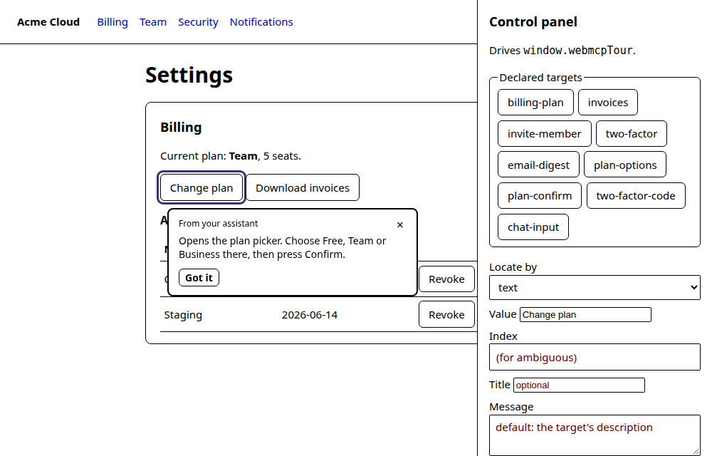

The overlay is built to be usable without a mouse or a screen, and it is tested with axe and in forced-colors and reduced-motion emulation.

## Screen readers

- A persistent **live region** (`role="status"`, `aria-live="polite"`, `aria-atomic="true"`) is put in the page at load, before the first step, so assistive technology has registered it by the time something is announced. It is cleared and set again after a short beat so repeated messages are heard.
- A step is announced as `<message> — <control name>, <landmark>`, for example "Pick a plan and press Confirm. — Change plan, Billing". A page suggestion announces its text.
- The card is a `role="group"` labelled by the attribution text ("From your assistant"), so it is always clear who is speaking. The × button has its own label (`labels.close`).
- `describeTarget: true` also points the target's `aria-describedby` at a hidden copy of the message while the step shows, and restores the original on dismiss. Off by default, because it edits the page's own element.

## Keyboard

- The buttons are real `<button>` elements in the tab order: **Got it**, **Take me there** (if enabled), **Go to …**, **Not now**, and ×.
- **Escape** dismisses the step or suggestion, from inside the card or when nothing else on the page claimed the key.
- The card never steals focus. A page suggestion is focusable (`tabindex="-1"`) so keyboard users can reach it, but is not focused for you.
- **Take me there** (opt-in) scrolls the control into view and moves focus to it with a visible focus ring. A control that cannot take focus gets `tabindex="-1"` until it blurs.
- The spotlight is `pointer-events: none`, so it never blocks a click on the control. A page-suggestion backdrop never blocks the page either.

## Colours and motion

- **System colours.** The card and spotlight use `Canvas`, `CanvasText` and `AccentColor`, with `color-scheme: light dark`, so they follow the page's scheme. Override with the `--tour-*` properties ([Engine API](engine-api.md)); keep the contrast.
- **Forced colors** (`forced-colors: active`): the spotlight outline is `Highlight`, the card has a 2px `CanvasText` border, and buttons use `ButtonText` and `ButtonFace`.
- **Reduced motion** (`prefers-reduced-motion: reduce`): transitions are off and the **Take me there** pulse is skipped.

## Small screens and zoom

- Below 480px wide (or 420px tall, which includes 400% zoom) the card is more compact and the action buttons come first, so they never land below the fold.
- The card has a maximum height and scrolls inside itself; it is clamped to the viewport.
- Positioning follows the control as the page scrolls or resizes. A control scrolled out of view hides the card instead of leaving it stranded.

## Modal dialogs

The overlay mounts inside an open modal `<dialog>`, so it is not inert and can point at the dialog's controls. When a modal is open and the target is behind it, the step is refused with `obscured`.

## Your part

Highlighting does not make a control accessible. Give controls an accessible name (the tools find them by it) and keep descriptions short and in plain language. Translate the `labels` ([Concepts](concepts.md)).
