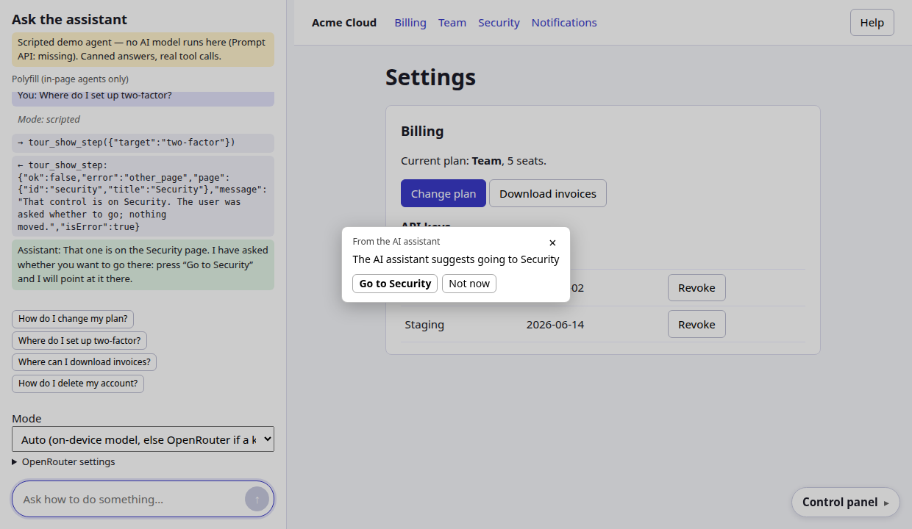
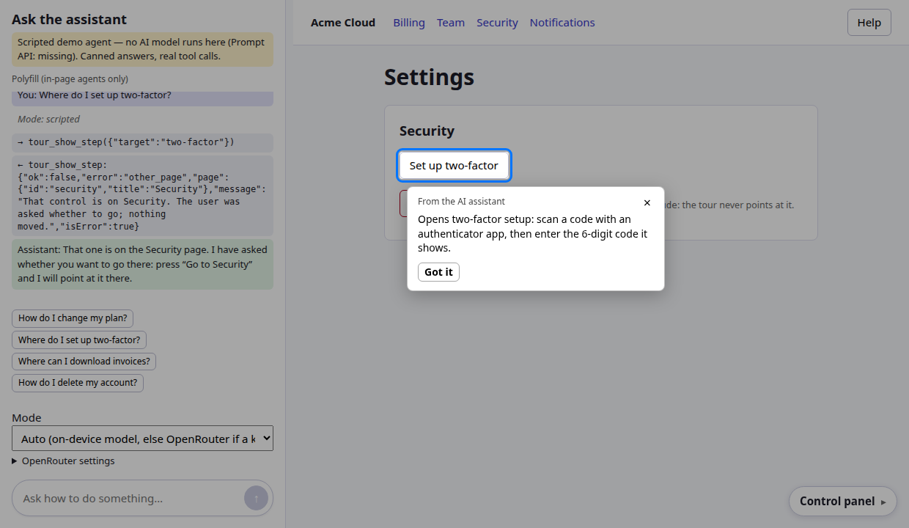
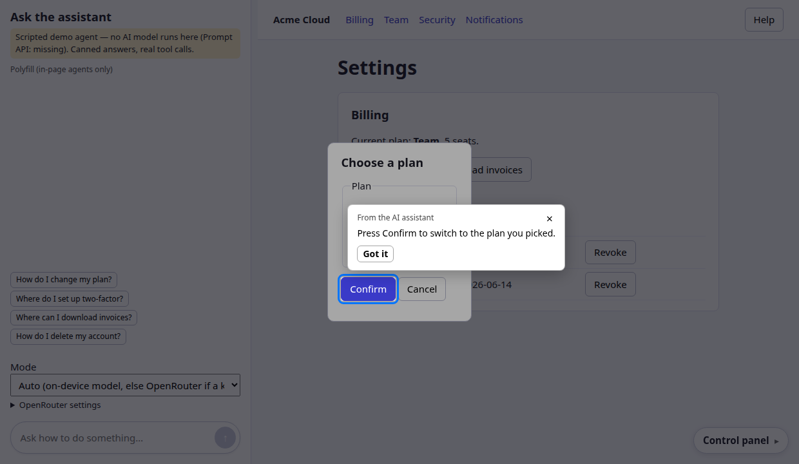

## Targets

A **target** is a control the agent can point at by id. There are three ways to point at something, tried in this order by the resolver:

1. `target`: a declared id (`data-tour-id="two-factor"`, or `tour.defineTarget`).
2. `selector`: a CSS selector. Matches **visible** elements only.
3. `text`: the visible text, label or `aria-label` of the element.

Exactly one is given per step. `text` and `selector` need no setup, and either can be turned off with `locators: { text: false }`. Ambiguity is never guessed: if two elements match, the result is `ambiguous` with a list of candidates (each with its heading, row text and landmark), and the agent retries with `index`.

Declare a target in markup or in code:

```html
<button data-tour-id="invoices" data-tour-description="Downloads every invoice as a ZIP.">Download invoices</button>
```

```ts
tour.defineTarget({
  id: "help-chat",
  selector: "#help",            // or `element`
  label: "Help",                // accessible-name override in lists
  description: "Opens the support chat.", // default card text
  reveal: "Open the menu first.",         // returned as not_visible.reveal when hidden
});
```

| Attribute | Definition field | Meaning |
|---|---|---|
| `data-tour-id` | `id` | The target id. |
| `data-tour-description` | `description` | Default `message` when the agent gives none. Also listed for the agent (clipped to 300 characters). |
| `data-tour-label` | `label` | Name shown in lists (clipped to 80 characters). Default: the element's accessible name. |
| `data-tour-reveal` | `reveal` | What to do first when the element is hidden (a collapsed section, another tab). Returned with `not_visible`. |
| `data-tour-page` | `page` | The page id the target lives on. |
| `data-tour-exclude` | — | Never pointed at, and its text never leaks into names. On any element. |

A target **hidden** right now answers `not_visible`, with the `reveal` hint if there is one. In `tour_list_targets` it is listed with `visible: false`.

Targets you want never to be highlighted (delete workspace, say) get `data-tour-exclude`, or match the tour-wide `exclude` selector option. An excluded element behaves as if it did not exist.

## Pages

Tell the tour about the app's pages and the agent can say "that control is on another page":

```ts
const tour = createTour({
  pages: [
    { id: "billing", url: "/billing", title: "Billing", description: "Plan and invoices." },
    { id: "security", url: "/security", title: "Security" },
  ],
  navigate: (url) => router.push(url), // default: location.assign
});
tour.definePage({ id: "team", url: "/team", title: "Team" }); // later, for dynamic apps
tour.defineTarget({ id: "two-factor", page: "security", label: "Set up two-factor", description: "Starts two-factor setup." });
```

- **Current page.** The first page whose `match` accepts `location`. `match` is optional: a string is a `location.pathname` prefix, a `RegExp` is tested against the pathname, a function gets `location`. Without it, the page's `url` path must equal `location.pathname`.
- **Targets on a page.** `defineTarget({ id, page, label, description })` needs no element: it only says where the control lives. On its own page the real element comes from `data-tour-id="two-factor"` (or `selector` / `element` on the definition). `data-tour-page="<page id>"` does the same in markup. A target whose page is not the current one is **off-page**: it is never highlighted.
- **`tour_list_targets`** returns the current `page`, the other `pages`, and every target; off-page ones carry `page: { id, title }` and `onThisPage: false`.
- **`tour_show_step`** takes a fourth locator, `{ page: "security" }`. For an off-page target, or an explicit `page`, it shows a card with no spotlight: the `otherPage` text, **Go to Security** and **Not now**. The result is `{ ok: false, error: "other_page", page }` for a target, and `{ ok: true, suggested: page }` for a `page` locator. A call never navigates; only the user's click on **Go** calls `navigate(url)`.
- **Waiting.** With a suggestion on screen, `tour_wait_for_interaction` resolves `{ status: "navigating" }` on **Go** and `{ status: "dismissed" }` on **Not now**, the × button, or Escape.



For a single-page app, pass `navigate` (your router's push) so the page does not reload and an agent embedded in the page stays alive. A full page load restarts an embedded agent (the highlight still resumes, see below).

## The page outline

Agents inside the page (an on-device model, a hosted model called from page script) cannot see it. `tour_list_targets` therefore also returns what a person sees:

```json
{
  "outline": {
    "headings": ["Settings", "Billing"],
    "controls": [
      { "role": "button", "name": "Change plan", "context": "Billing" },
      { "role": "link", "name": "Team", "context": "Account" }
    ]
  }
}
```

Controls are visible links, buttons, fields (by label), selects, tabs and menu items. `name` is the accessible name and `context` is the nearest labelled landmark, else the heading above, else the bare landmark. The agent points at one with `tour_show_step({ text })`. The tool is registered whenever a document exists, even with nothing declared. `tour.outline()` returns the same object.

Privacy: the outline never contains field values, attributes, URLs or hidden content. `scope`, `exclude`, `data-tour-exclude`, `aria-hidden`, `inert` and the tour's own overlay are honoured. Limits: **60 controls**, **30 headings**, names clipped to **60 characters**; `truncated: true` when something was dropped.

## Resuming the step after navigation

When the user presses **Go**, the tour keeps the step it was heading for and shows it on the destination.

```ts
createTour({ resume: { param: "webmcp-tour" } }); // the default; `resume: false` turns it off
// Go -> navigate("/security?webmcp-tour=9f2c…")
```



- **What is stored.** The step (page id, target, title, message, a timestamp) goes in `sessionStorage` under a random nonce. Only the nonce is added to the destination URL, as the `param` query parameter.
- **On load**, or for a single-page app after `navigate()` returns, the tour looks the nonce up. A fresh entry (at most **2 minutes** old) is shown as the step as soon as its target is on the page (a `MutationObserver` watches for it, for at most **5 seconds**). Then the parameter is removed with `history.replaceState` and the entry is deleted: **one use**.
- **Safety.** The message, title and target never go in the URL. A link with an unknown, expired or already used nonce shows nothing, so nobody can craft a link that makes your site display text "from the AI assistant". Same-origin destinations only: a URL on another origin is used as is, with no nonce.
- **What the agent sees.** The next tool result after a resume carries `resumed: { page, target? }` (`tour.takeResumed()` gives the same once). A `tour_wait_for_interaction` that ended with `navigating` is finished for good; one called with no arguments while a resume is still looking for its target waits for it, then waits on the resumed highlight.
- **Full page loads.** An agent embedded in the page restarts, but the highlight still resumes: it does not depend on the agent. If your `navigate` appends its own query string, build it from the URL it is given (it already carries the nonce).

## Labels and translations

Every user-facing string, and the card's aria labels, comes from `labels`. All keys are optional; these are the defaults:

```ts
createTour({
  labels: {
    gotIt: "Got it",
    takeMeThere: "Take me there",
    close: "Dismiss", // aria label of the × button
    attribution: "From the AI assistant", // visible, and the card's aria label
    goToPage: "Go to {page}", // {page} is the page title
    notNow: "Not now",
    otherPage: "The AI assistant suggests going to {page}",
  },
});
```

`{page}` is replaced in `goToPage` and `otherPage`. Labels are set as text, never parsed as HTML. Titles and messages come from the agent, so they are in whatever language the agent writes; your `data-tour-description` text is in yours.

### "Got it" and "Take me there"

Each step shows a card with **Got it** next to the highlighted control. Pressing it dismisses the step and tells the agent: a pending `tour_wait_for_interaction` resolves `{ ok: true, status: "acknowledged" }`, and `tour.on("dismiss")` reports `reason: "acknowledged"`. For a card that also scrolls to the control, focuses it (with a visible focus ring) and pulses the spotlight, opt in:

```ts
createTour({ takeMeThere: true });
```

The pulse is skipped under `prefers-reduced-motion`.

## Where the suggestion card goes

```ts
createTour({ pageSuggestion: { placement: "center" } }); // "center" (default) | "anchor" | "corner"
```

- **`center`**: the card is centred in the viewport, in the top layer, over a light backdrop that never blocks the page (`pointer-events: none`; the card is a non-modal popover). It is focusable (`tabindex="-1"`, but not focused for you) and announced through the live region. Escape and **Not now** dismiss it.
- **`anchor`**: the card attaches to an on-page element marked `data-tour-page="<page id>"` (say, the nav link) and rings it. The marked element must not also carry `data-tour-id` (that marks a target) and must be visible, in `scope` and not excluded; when none is, the card is centred instead.
- **`corner`**: bottom-right.

Forced-colors, reduced-motion and `labels` apply to all three.

## Step placement and modals

`placement` on a step is `auto` (default: below the control, flipping when it does not fit), `above` or `below`. The card uses CSS anchor positioning where the browser supports it and a computed fixed position where it does not.

If a modal `<dialog>` is open, the page behind it is inert, so pointing there is pointless: the result is `obscured`. A control **inside** the open dialog can be pointed at (the overlay mounts inside the dialog so it is not inert).


