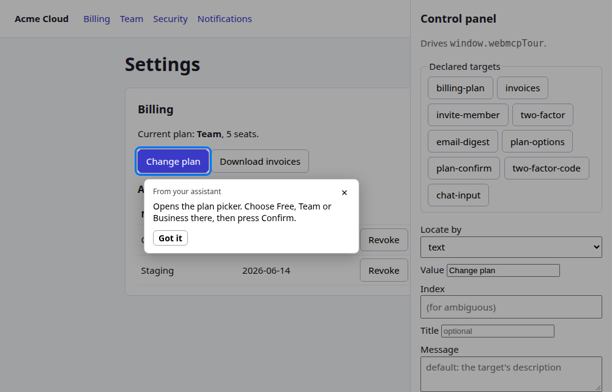

## Live demo

[Open the live demo](demo/): a fake settings app (Acme Cloud) with four pages (Billing, Team, Security, Notifications), the tour tools registered, a control panel that drives `window.webmcpTour` by hand, and an **Ask the assistant** panel. It runs entirely in your browser; nothing is sent anywhere unless you choose the OpenRouter mode and enter a key.

By default the assistant is a **scripted agent**: canned question-to-tool-call mappings and no AI model. The tool calls are real. If your Chrome has the Prompt API and its model, the page can use that instead.

Try this:

1. On Billing, press **How do I change my plan?**. The **Change plan** button is highlighted with its card.

   

2. Ask **Where do I set up two-factor?** from Billing. That control is on Security, so a card appears in the middle of the page: **Go to Security** / **Not now**. Nothing moves until you click.
3. Press **Go to Security**. The app switches page and the step **resumes**: **Set up two-factor** is already highlighted.
4. The controls work, so guidance can span steps: **Change plan** opens a plan picker (a modal dialog with declared targets for the options and **Confirm**).

The demo needs WebMCP: on Chrome without it, the page loads the W3C polyfill. In a browser that blocks the polyfill or has no secure context, the assistant says so and turns itself off.

## Runnable examples

Three small apps live in the repository's `examples/` folder. Each starts with one command (see the repository README); none needs a build for the page itself apart from the library.

### Script tag (`examples/script-tag`)

A plain HTML "Northwind" settings app with Billing, Team, Security and Notifications tabs. One `<script src="…/webmcp-tour.js">` registers the tools.

- **Declared targets** (`data-tour-id`, `data-tour-description`): Change plan, Download invoices, Invite member, Set up two-factor, Daily email digest.
- **Undeclared controls**: Update card, Save billing email and two identical Remove buttons. The agent finds them by visible text; the Remove pair needs `index`.
- **`data-tour-exclude`**: Delete workspace is never pointed at.
- **`data-tour-reveal`**: Set up two-factor sits in a collapsed section on another tab, so pointing at it returns `not_visible` with "Open Security, then expand Advanced."

Try: "How do I change my plan?", "Show me how to remove Lee Park from the team.", "Where can I delete the workspace?" (it should not point).

### Bundled (`examples/bundled`)

A small Vite single-page app (Dashboard, Projects, Settings) that imports `webmcp-tour/auto`. It declares its three routes with `pages` and passes `navigate` (the SPA router). Ask for "Create API token" from the Dashboard: the agent gets `other_page`, a card offers **Go to Settings** / **Not now**, and after Go the tour resumes the step on the new route. The agent stays alive because the page never reloads.

Try: "How do I start a new project?", "Show me where to create an API token.", "Where do I turn off the daily email digest?"

### Embed (`examples/embed`)

Uses the engine directly. It creates a tour, registers an app tool of its own and registers the tour tools under custom names (`settings_point_at`, `settings_list_controls`, `settings_clear_point`, `settings_wait_for_click`). `change_plan` stages a plan change in the UI, then calls `tour.show({ target: "confirm-plan", … })` inside `execute`, and returns `{ staged: true, pointed: true }`: the user still clicks Confirm.

Try: "Switch us to the Business plan.", "Change the plan to Enterprise." (not a valid plan: expect an error and no highlight).

The example sources are in the [repository](https://github.com/fboldo/webmcp-tour/tree/main/examples). While it is private you need access to it.
