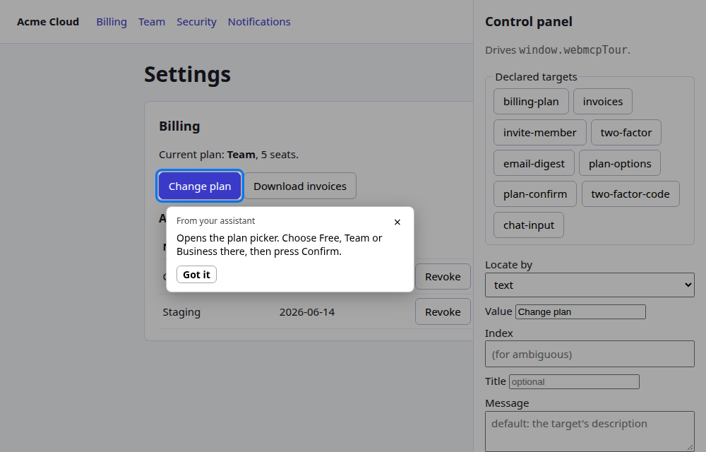

**webmcp-tour** lets an AI agent show a user where to click, instead of clicking for them. The agent highlights the control, explains it in a short card, and the user does the action themselves.

[Try the live demo](demo/) · [Quick start](quick-start.md) · [Tools reference](tools.md)

It is a zero-dependency TypeScript library for the browser. It registers four [WebMCP](https://github.com/webmachinelearning/webmcp) tools on the page, so any agent that can call WebMCP tools (a browser's built-in assistant, an MCP client driving Chrome, or a model called from your own page script) can point at things.

The library is **experimental** (0.x): the API may change between minor versions, and WebMCP itself is still evolving. These docs describe the code in the repository as it is.

## Guidance instead of automation

An agent that answers "how do I change my billing email?" has two options:

| | Agent acts | Agent guides (webmcp-tour) |
|---|---|---|
| What happens | The agent clicks and types for the user | The agent highlights the control and explains it |
| Who does the action | The agent | The user |
| Risk | A wrong click changes real data, spends money or sends a message | The worst case is a wrong highlight, which the user can ignore |
| Trust | The user has to trust the agent with their account | The user stays in control, and learns where things are |
| Tools are | Read-write, often consequential | Read-only: they never click, type or navigate by themselves |

Guidance is the right default for help, onboarding and "where is X?" questions. It is also the safe option for anything consequential: pay, delete, invite, publish. The agent shows the button; the person decides to press it.

Every tool carries `readOnlyHint: true`. Nothing in the library clicks, types or changes a page. Navigation happens only when the user presses **Go** on a suggestion card ([Security and privacy](security.md)).

## Two ways to use it

**The zero-shot primitive.** Add one script tag. The agent calls `tour_list_targets` to read a visible outline of the page (headings, and controls with role, name and context), then `tour_show_step({ text: "Change plan", message: "…" })` to point at a control by its visible text. No markup, no configuration. This works on any page and is the way to start. See [Quick start](quick-start.md).

**The declared map.** You tell the tour what your app has: targets (`data-tour-id`) with labels and descriptions, pages with URLs, and how to navigate. The agent then answers from your descriptions, can say "that control is on the Security page" and offer a **Go to Security** card, and the step **resumes** on the new page after the user presses Go. See [Concepts](concepts.md).

| | Zero-shot | Declared map |
|---|---|---|
| Setup | A script tag | `data-tour-id` attributes, `pages`, `navigate` |
| The agent finds controls by | Visible text, accessible name, or a CSS selector | The same, plus ids you chose |
| Descriptions | Written by the agent each time | Written by you, shown by default |
| Other pages | Not known | Suggested with a card; resumes after Go |
| Best for | A quick start, a site you do not control | Your own product, where wording matters |

You can mix them freely: declared targets are an addition, not a mode.

## What the user sees

- A spotlight ring around the control, and a card beside it labelled **From your assistant** (so a page cannot pass the text off as its own) with a **Got it** button.
- Optionally **Take me there**, which scrolls to the control, focuses it and pulses the ring.
- For a control on another page: a card in the middle of the viewport, **Go to Security** or **Not now**, and nothing moves until the user picks.

The overlay uses system colours, supports light and dark, forced-colors and reduced motion, and is announced to screen readers ([Accessibility](accessibility.md)).

## Where to go next

- [Quick start](quick-start.md): a script tag, or a bundler.
- [Concepts](concepts.md): targets, pages, the outline, resume, labels and placement.
- [Tools reference](tools.md) and [Engine API](engine-api.md): exact inputs and results.
- [Agent hosts](agent-hosts.md): Playwright MCP, Chrome, and in-page agents.
- [FAQ](faq.md): how this differs from browser agents, size, SSR.
